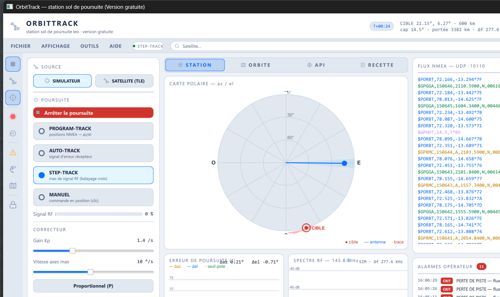
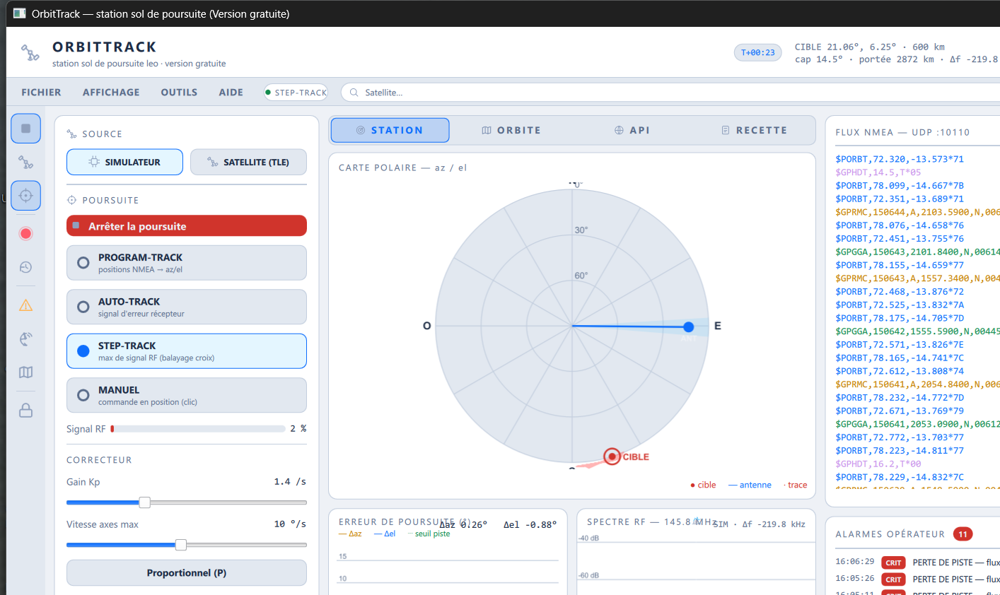
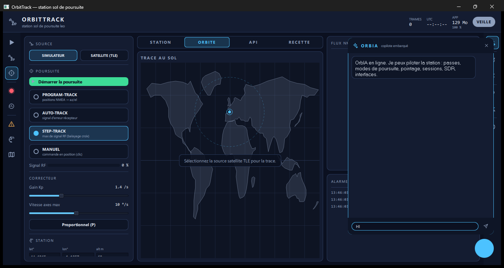
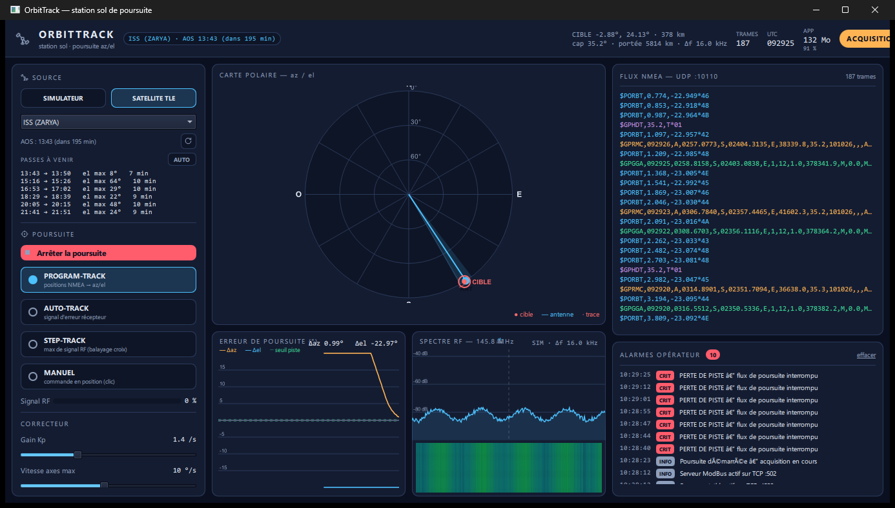
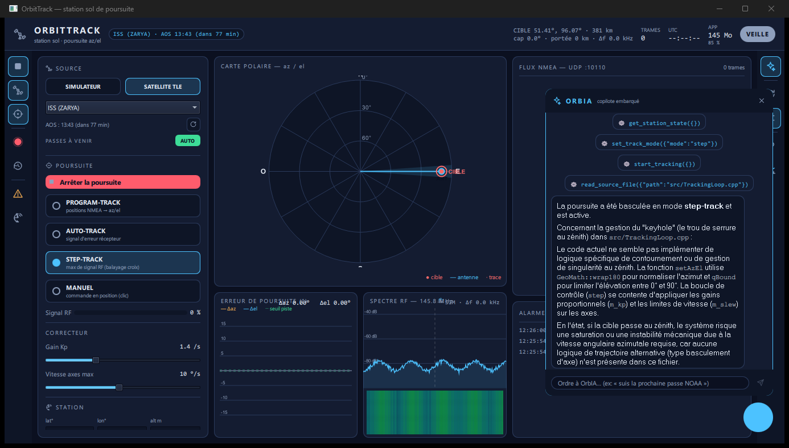
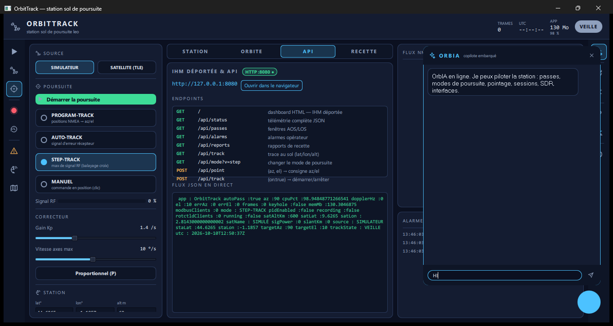
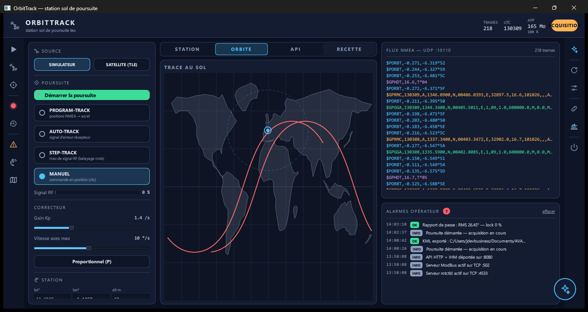

# OrbitTrack 🛰

**Ground-station antenna control software for LEO satellite tracking.**
Station de poursuite d'antenne pour satellites LEO — **C++20 / Qt 6 / QML**
under Windows.

> Développé intégralement par **Juste Elysée MALANDILA** — Brazzaville, Congo.
> 📫 malandilajusteelysee@gmail.com · linkedin.com/in/justelm · yusticanum.com

---

## 🇫🇷 Présentation

OrbitTrack pilote une station de réception au sol : il pointe une antenne
azimut/élévation vers un satellite en mouvement et le poursuit
automatiquement, de l'acquisition de la cible jusqu'à la recette de passe.
L'objectif : un vrai rotor (type Yaesu G-5500) pour capter les balises et
télémesures des cubesats — l'approche SatNOGS / GPredict / Orbitron, avec
en plus la boucle de poursuite elle-même, conçue comme un logiciel
industriel (protocoles, alarmes auditées, auto-test, traçabilité).

### Modes de poursuite

| Mode | Principe |
|---|---|
| **PROGRAM-TRACK** | Positions cible via trames NMEA → az/el (WGS84 → ENU) → correcteur vers les axes |
| **AUTO-TRACK** | Signal d'erreur du récepteur monopulse (`$PORBT`) — comme sur les vraies stations |
| **STEP-TRACK** | Balayage en croix et dérive vers le maximum de signal RF |
| **MANUEL** | Commande en position — clic direct sur la carte polaire |

### Trajectographie réelle

- Propagateur **SGP4** complet — catalogue **TLE** embarqué +
  téléchargement CelesTrak, prévision des fenêtres **AOS/LOS**
- **Ordonnanceur multi-satellites 24 h** : démarrage/arrêt automatique
  des poursuites aux fenêtres de visibilité
- **Trou de serrure zénithal** : détection, alarme opérateur et boost
  de vitesse azimut (×4), comme sur les vraies montures

### Interfaces équipements & protocoles

| Protocole | Rôle |
|---|---|
| **Modbus TCP :502** | Serveur — registres industriels float32 (position, cible, alarmes, keyhole) ; FC03/04/06/10, consignes de pointage en écriture |
| **rotctld :4533** | Serveur compatible Hamlib — pilotable depuis GPredict / SatPC32 |
| **rotctld client** | Pilotage d'un rotor distant |
| **Easycomm II** | Sortie rotor sur port série |
| **NMEA 0183 / UDP** | Parseur complet avec checksum XOR — GGA / RMC / HDT / PORBT |
| **rtl_tcp** | Spectre RF par FFT, waterfall, correction Doppler |
| **HTTP :8080** | API REST + dashboard déporté en JSON |

### Supervision & recette

- Alarmes hiérarchisées avec **acquittement audité**
- **BIT** (auto-test embarqué) : 11 contrôles au démarrage et à la demande
- Watchdog logiciel (gel boucle / flux interrompu), surveillance de
  fraîcheur des éphémérides, verrou console opérateur/superviseur
- Rapports de passe **notés A–D** (RMS az/el, % lock), export **CSV/KML**,
  enregistrement/rejeu horodaté des sessions NMEA

### IHM

- Carte polaire az/el avec trace de passe et faisceau antenne,
  carte monde avec trace au sol, graphe d'erreur temps réel,
  console de trames brute
- **7 langues · 7 thèmes**, composants Qt Quick sur mesure
- **OrbIA** — copilote agentique embarqué qui pilote réellement la
  station par function calling (~25 outils : modes, pointage,
  planification, exports, vues). « Suis NOAA 19 en step-track » →
  il enchaîne les appels tout seul
- Entrée vocale, écran de démarrage, splash animé

### Engineering

| Aspect | Détail |
|---|---|
| Volume | ~4 700 lignes C++ · ~8 300 lignes QML · 20 composants UI |
| Build | CMake · MSVC · Qt 6.5 · windeployqt |
| Tests | Self-test C++ **27/27** — parseurs NMEA/TLE, SGP4, ECEF↔LLA, validation des checksums (rejet des trames invalides) |
| Validé par | Clients Modbus/rotctld externes réels, curl API, stabilité mémoire sous stress (~97–145 Mo constants) |

## 📸 Galerie

| Carte monde | Planificateur de passes | Copilote OrbIA |
|---|---|---|
|  |  |  |

| API déportée | Rapport de recette |
|---|---|
|  |  |

## 📥 Démo

L'exécutable de démonstration (Windows x64) sera publié dans
[Releases](https://github.com/jdevseer9/OrbitTrack/releases).
Le code source n'est pas public — disponible **sur demande** pour les
recruteurs et partenaires techniques.

## 🗺 Roadmap

- Décodage des balises/télémesures cubesat pendant la passe
- Asservissement PID complet (au-delà du correcteur actuel)
- Support SGP8/SDP4 (orbites hautes)
- Liaison rotor réelle (Yaesu G-5500) & réception live
